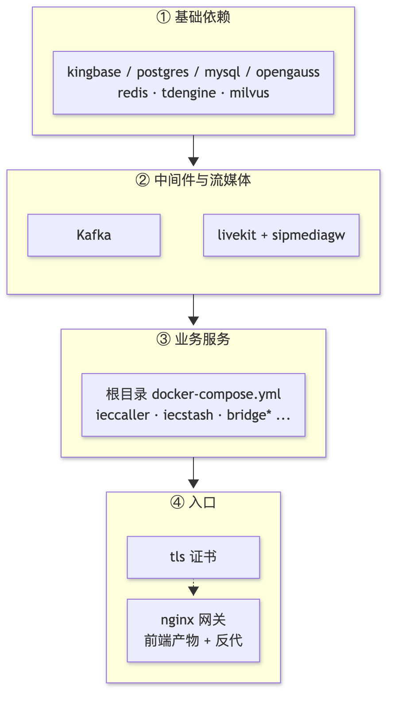

# deploy 部署模板总览

`deploy/` 放本地开发与现场部署用的模板集合：每个子目录自带 `docker-compose` 与运维脚本，独立成项目，互不共享容器、网络和生命周期。这里的编排不是开箱即用的生产环境，使用前必须替换镜像、宿主机路径和端口。

业务服务本身的镜像模板是根目录的 [`docker-compose.yml`](./docker-compose.yml)（默认含 Kafka、Filebeat、`ieccaller`、`iecstash`、`bridgegtw`、`bridgedump` 与 Kafdrop），用法见[部署指南](../docs/deployment.md)。

## 目录导航

| 目录 | 用途 | 入口 |
| --- | --- | --- |
| [`kingbase/`](./kingbase/README.md) | KingbaseES V9R1C10 单机（PG 兼容模式） | `deploy.sh` · `docker-compose.yaml` · `init.sql` · `roles.sql` |
| [`postgres/`](./postgres/README.md) | PostgreSQL 16 单机 | `deploy.sh` · `docker-compose.yaml` · `roles.sql` |
| [`mysql/`](./mysql/README.md) | MySQL 8.4 单机 | `deploy.sh` · `docker-compose.yaml` · `roles.sql` |
| [`opengauss/`](./opengauss/README.md) | openGauss 7.0 单机（持久化） | `deploy.sh` · `docker-compose.yaml` |
| [`redis/`](./redis/README.md) | Redis 7（AOF 持久化） | `deploy.sh` · `docker-compose.yaml` |
| [`tdengine/`](./tdengine/README.md) | TDengine TSDB 3.4 单机与业务库初始化 | `deploy.sh` · `init.d/` |
| [`milvus/`](./milvus/README.md) | Milvus Standalone（etcd + MinIO + Attu） | `docker-compose.yaml` |
| [`kdts/`](./kdts/README.md) | Kingbase KDTS-WEB 数据迁移 | `deploy.sh` |
| [`dbswitch/`](./dbswitch/README.md) | dbswitch 异构迁移（KDTS 替代方案） | `deploy.sh` |
| [`nginx/`](./nginx/README.md) | Web 网关：前端托管、反代、TLS、健康检查 | `build-web.sh` · `deploy.sh` |
| [`livekit/`](./livekit/README.md) | LiveKit + Egress 录制与 Token 脚本 | `start.sh` · `stop.sh` · `gen-token.sh` |
| [`sipmediagw/`](./sipmediagw/README.md) | SIPMediaGW 完整部署单元（Kamailio/Coturn/Homer） | `provision.sh` |
| [`filebeat/`](./filebeat/conf/filebeat.yml) | 日志采集配置 | `conf/filebeat.yml` |
| [`tls/`](./tls/gen-tls.sh) | 自签 TLS 证书生成（供 nginx 使用） | `gen-tls.sh` |

## 依赖关系与启动顺序

数据库与 Redis 是业务服务和 LiveKit 的共同前置依赖；`nginx` 最后部署，因为它依赖前端产物与已启动的上游服务。

  

推荐顺序（与上图编号一致）：

1. **① 基础依赖**：`kingbase`（或 `postgres`/`mysql`/`opengauss`）、`redis`，需要时序或向量能力时再加 `tdengine`、`milvus`；数据迁移在库就绪后执行 `kdts` 或 `dbswitch`。
2. **② 中间件与流媒体**：`livekit`、`sipmediagw`；Kafka 使用根目录 `docker-compose.yml` 或自建集群。
3. **③ 业务服务**：按目标链路上线，例如 IEC 104 需要 `ieccaller` + `iecstash` + `facade/streamevent`；`filebeat` 随业务服务一起采集日志。
4. **④ 入口**：`tls` 生成证书后部署 `nginx`，再按需接入 `web/` 前端产物。

## 通用约定

- 每个目录的数据目录（`data/`、`deploy/livekit/recordings/`、`deploy/nginx/dist/`）默认 gitignore，删档前先确认是否已备份。
- 数据库类目录的 `deploy.sh` 统一为子命令模式：无参数为部署（幂等，可重复执行），另支持 `stop`、`restart`、`status`、`logs`；`kingbase` 额外提供 `license` 与 `ksql`。
- 首次初始化后才能改动的环境变量（账号、密码、端口映射）只在数据目录为空时生效，改配置前先读对应 README。
- 示例中的账号口令仅用于本地联调，现场部署必须替换，且不要提交到仓库。
- 服务端口分配见[服务端口清单](../docs/service-ports.md)；前端构建与网关细节见 [`nginx/README.md`](./nginx/README.md)。
