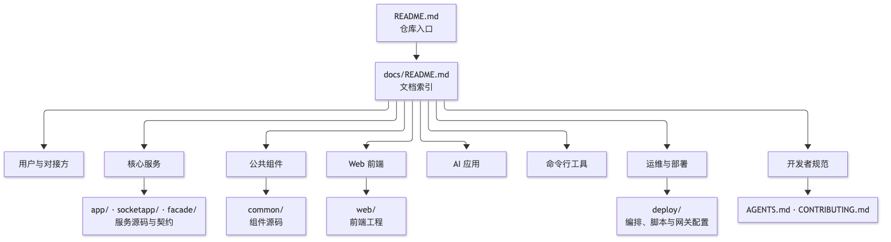

# 文档索引

这里集中放置 Zero-Service 的用户、对接方和开发者文档。项目由多个可以独立运行的服务组成，请先根据使用场景选择服务，再阅读对应的配置和部署说明。

## 推荐阅读路径

1. 从[快速开始](./quick-start.md)准备环境并启动一个服务。
2. 通过[架构概览](./architecture.md)了解服务分层和主要数据流。
3. 查看[服务端口清单](./service-ports.md)确认服务入口。
4. 根据协议或业务场景进入下方的专项文档。

## 文档地图

`README.md` 只做仓库入口，本文件是唯一索引；链接方向固定为「入口 → 索引 → 专项文档 → 源码或脚本」，文档之间不互相引用成环。新增文档时先在本索引登记，再补交叉链接。

  

写作约定：

- `docs/` 放跨服务的架构、协议、对接与规范；单个服务的实现细节放各自目录的 `README.md`。
- 每篇文档先给结论或表格，再展开细节；命令与配置一律使用 fenced code block。
- 架构图与流程图统一放在 [`docs/images/diagrams/`](./images/diagrams/)，同目录保留同名 `.mmd` 源文件；正文用 `` 引用导出的 PNG，避免依赖编辑器是否支持 Mermaid。
- 端口、路径和字段以源码、`.proto`/`.api` 与 `etc/*.yaml` 为准，写文档时同步核对。

## 用户与对接方

| 文档 | 内容 |
| --- | --- |
| [快速开始](./quick-start.md) | 环境要求、安装、启动示例、常见问题 |
| [架构概览](./architecture.md) | 系统分层、模块依赖、数据流和技术选型 |
| [服务端口清单](./service-ports.md) | 各服务默认端口、协议和用途 |
| [错误码规范](./error-codes.md) | 错误码维度、模块分配、HTTP/gRPC 映射与网关返回契约 |

## 核心服务

| 服务 | 文档 | 内容 |
| --- | --- | --- |
| IEC 104 | [数采平台](./iec104/README.md) | 采集、消息分发、数据合并与控制命令 |
| Trigger | [Trigger 服务](./trigger/README.md) | 异步任务、计划任务、RRULE CronJob |
| SocketIO | [实时通信](./socketio/README.md) | 网关对接、事件体系、房间广播和鉴权 |
| DJI | [云平台](./djicloud/README.md) | 第一代上云 API 参考实现（Dock 3 Cloud API 与航点任务文件）；新项目建议[上云 API 2](https://developer.dji.com/cn/cloud-api-2) |
| ISP | [巡检协议](./isp/README.md) | ISP 服务端/代理、帧格式、任务和模型同步 |
| LiveKit | [视频会议](./live/README.md) | 会议管理、入会 token、票据邀请、Webhook、聊天消息；[LiveKit](https://github.com/livekit/livekit) · [Server SDK](https://github.com/livekit/server-sdk-go) · [对接指南](./live/integration-guide.md) |
| Oryx | [流媒体](./oryx/README.md) | HTTP 回调网关、gRPC API 代理、录制管理与中继拉流；[Oryx](https://github.com/ossrs/oryx) · [SRS](https://github.com/ossrs/srs) |
| LAL | [流媒体回调](../app/lalhook/README.md) | LAL HTTP 回调事件与 gRPC 代理（已不推荐，迁移至 Oryx）；[LAL](https://github.com/q191201771/lal) |
| File | [文件与对象存储](./file/README.md) | OSS 配置管理、文件上传/中继、签名 URL 与视频截帧 |
| GIS | [地理信息服务](./gis/README.md) | H3、GeoHash、电子围栏与坐标转换 |
| PodEngine | [容器编排](./podengine/README.md) | Docker 容器生命周期管理 |
| OpenAPI | [开放 API 网关](./open-api/README.md) | Basic 鉴权、统一信封、method 路由、Podman + Modbus |
| Bridge | [协议桥接](./bridge/README.md) | HTTP/Kafka/Modbus/MQTT 桥接与报文落地 |

`gtw`（存量 BFF）、`zerorpc`、`alarm`、`logdump`、`xfusionmock` 等服务暂无专项文档，端口与目录以[服务端口清单](./service-ports.md)为准，实现细节见各自目录源码。

## 公共组件

| 组件 | 文档 | 内容 |
| --- | --- | --- |
| antsx | [并发编排指南](./antsx-vs-reactive.md) · [README](../common/antsx/README.md) | 泛型异步编排、Stream API、协程池与 reactive 写法对比 |
| bytex | [README](../common/bytex/README.md) | 字节/数值转换、位操作与 Modbus 寄存器约定 |
| flowx | [README](../common/flowx/README.md) | 基于 Azure/go-workflow 的 go-zero 集成封装 |
| gormx | [README](../common/gormx/README.md) | 多库 GORM 封装：回调、租户、软删、分页、日志与追踪 |
| gisx/geos | [README](../common/gisx/geos/README.md) · [API 指南](../common/gisx/geos/API-GUIDE.md) | GEOS 几何引擎 CGO 封装与函数清单 |
| livekitx | [README](../common/livekitx/README.md) | LiveKit Server SDK 封装：Twirp 管理 API、Token、Room、Webhook 验签 |
| nacosx | [README](../common/nacosx/README.md) | Nacos 注册中心适配与 `nacos://` gRPC resolver |

其余 `common/*`（`iec104`、`djisdk`、`socketiox`、`mqttx`、`ossx`、`gtwx`、`errx`、`asynqx` 等）暂以源码和引用它们的专项文档为准；补充时在组件目录下新增同名 `README.md`，并在本表登记。

## Web 前端

| 站点 | 文档 | 内容 |
| --- | --- | --- |
| Zero 工作台 | [前端工作台](../web/workspace/README.md) | 统一入口、健康检测、端点速查、GitHub 与命令面板 |
| Live 会议 | [Live 前端](../web/live/README.md) | 会议大厅、会议室、录制、邀请与本地 Token |
| SocketIO 测试 | [SocketIO 前端](../web/socketio/README.md) | 连接、消息、房间、事件与底部控制台 |
| OpenAPI 控制台 | [OpenAPI 前端](../web/openapi/README.md) | 开放 API 调试、应用管理与错误码速查 |

四个项目的组成、构建与验证状态见 [`web/COMPLETION.md`](../web/COMPLETION.md)。

## AI 应用

| 服务 | 文档 | 内容 |
| --- | --- | --- |
| aigtw / aisolo | [AI Solo Web UI](../aiapp/aigtw/static/solo/README.md) | 零构建 SPA、SSE 事件流、模式对齐与 6 种中断面板 |
| aisolo | [分布式与持久化部署](../aiapp/aisolo/docs/DISTRIBUTED_DEPLOYMENT.md) | 多副本会话、Checkpoint 与 RUNNING 租约 |
| aisolo | [Eino 联测指南](../aiapp/aisolo/docs/EINO_INTEGRATION_TESTING.md) | 工具、Skill、Workflow 与子 Agent 的联测步骤 |
| Skill 样例 | [calculator](../aiapp/aisolo/skills/calculator/SKILL.md) · [coder](../aiapp/aisolo/skills/coder/SKILL.md) · [example](../aiapp/mcpserver/skills/example/SKILL.md) | `SKILL.md` 结构与技能实现样例 |

## 命令行工具

| 工具 | 文档 | 内容 |
| --- | --- | --- |
| dtui | [Docker TUI](../cli/dtui/README.md) | 容器、镜像、compose 与部署管理，基于 `cli/uix` 壳 |

## 运维与部署

| 文档 | 内容 |
| --- | --- |
| [部署模板总览](../deploy/README.md) | `deploy/` 下数据库、中间件、网关与运维工具的编排入口与启动顺序 |
| [部署指南](./deployment.md) | Docker、单服务、集群部署与配置管理 |
| [数据库时区配置](./database-timezone.md) | Kingbase/openGauss/PostgreSQL/MySQL 四库时区设置、会话行为与重启持久性 |
| [Web 网关（Nginx）](../deploy/nginx/README.md) | 前端产物托管、反向代理、TLS 与健康检查 |
| [金仓部署](../deploy/kingbase/README.md) | KingbaseES 单机编排、授权替换与业务库初始化 |
| [TDengine 部署](../deploy/tdengine/README.md) | 时序库编排、业务库初始化与采集服务对齐 |

## 开发者

| 文档 | 内容 |
| --- | --- |
| [开发指南](./development.md) | 环境搭建、代码生成、模块扩展和调试技巧 |
| [网关标准开发流程](./gateway-standard.md) | 网关分层、路由鉴权、统一信封、错误码出口与新增接口验收 |
| [OpenViking 记忆系统](./openviking-memory.md) | 工程契约的记忆库部署、MCP 工具与同步流程 |
| [Agent 协作约定](../AGENTS.md) | 默认行为、修改范围与完成标准 |
| [贡献指南](../CONTRIBUTING.md) | 分支模型、提交规范、代码生成与 PR 要求 |
| [Superpowers 技能全量介绍](./superpowers.md) | AI 编程技能集：14 个技能的设计哲学、铁律与使用流程 |
| [Matt Pocock 技能全量介绍](./matt-pocock-skills.md) | AI 编程技能集：37 个技能的工程实践、调试诊断与需求拆分 |

错误码定义与折叠规则见上文的[错误码规范](./error-codes.md)，组件用法见[公共组件](#公共组件)。
