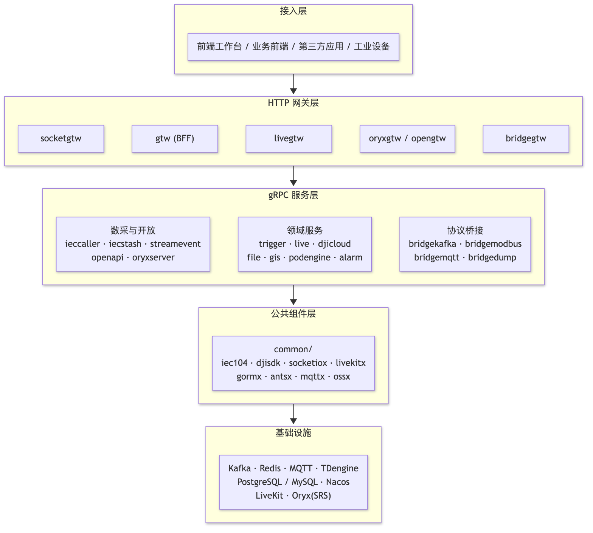
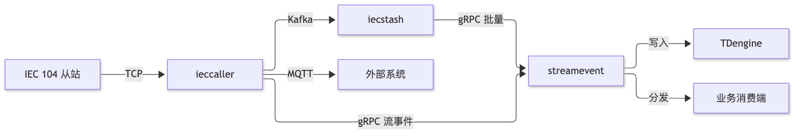
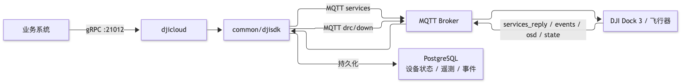
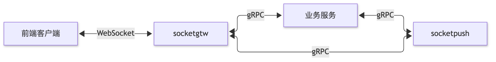
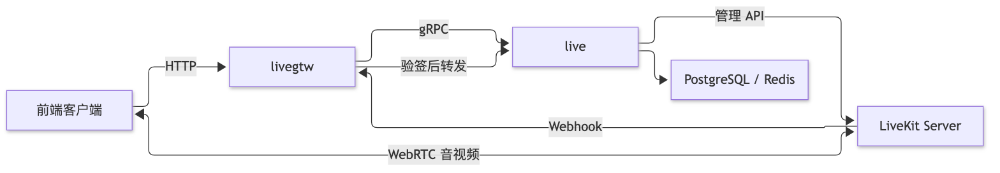
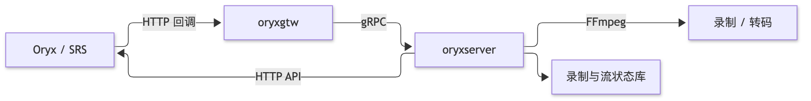
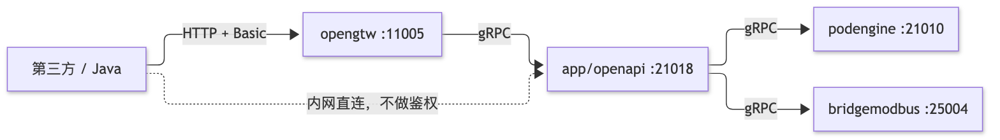

# 架构概览

Zero-Service 由一组可独立运行的服务组成，服务之间以 gRPC 为主干，横向通过 Kafka、MQTT、SocketIO 适配不同的实时性与吞吐需求。

## 系统架构

  

## 分层结构

| 层 | 组成 | 目录 |
| --- | --- | --- |
| 接入层 | 前端工作台、业务前端、第三方应用、工业设备 | `web/`、设备侧 |
| HTTP 网关层 | `gtw`(BFF)、`livegtw`、`socketgtw`、`oryxgtw`、`opengtw`、`bridgegtw`；`lalhook` 已不推荐 | `gtw/`、`app/*gtw/`、`socketapp/socketgtw/` |
| gRPC 服务层 | 领域服务、协议桥接、流处理与调度 | `app/`、`socketapp/`、`facade/` |
| 公共组件层 | 协议编解码、存储封装、并发原语、追踪与错误处理 | `common/` |
| 基础设施 | Kafka、Redis、MQTT Broker、关系数据库、TDengine、Nacos、LiveKit、Oryx(SRS)、LAL | `deploy/` |

依赖方向自上而下：网关只做协议适配与信封，业务语义留在 gRPC 服务；跨服务复用的能力下沉到 `common/`，不在服务之间互相引用内部包。

## 核心数据流

### 数采平台

  

`ieccaller` 采集后经 Kafka、MQTT、gRPC 三通道并行推送。`iecstash` 消费 Kafka 数据并批量转发给 `streamevent`，由 `streamevent` 完成点位过滤、分发和 TDengine 落库。流事件协议采用跨语言的 gRPC 定义，也可供其他语言实现端消费。详见[IEC 104 数采平台](./iec104/README.md)。

### DJI 云平台

  

两条下行通道：`services` 主题（请求-应答）用于航线、直播、调试等标准指令；`drc/down` 主题（即发即忘）用于杆量控制等高频指令。详见[DJI 云平台](./djicloud/README.md)。

### 实时通信

  

`socketgtw` 管理 SocketIO 长连接和房间，`socketpush` 提供后端推送接口。两者通过 gRPC 协作完成双向消息路由。详见[SocketIO 实时通信](./socketio/README.md)。

### 视频会议

  

`live` 管理会议单据、签发 join token、处理 Webhook 状态同步；`livegtw` 作为 HTTP 网关提供业务 API 并接收 LiveKit Webhook 验签后转发。浏览器获取 token 后直连 LiveKit Server 进行音视频通话。详见[视频会议](./live/README.md)。

### 流媒体

  

`oryxgtw` 接收 Oryx 五类回调并分发，`oryxserver` 封装 Oryx/SRS HTTP API 为 gRPC 接口供业务调用，覆盖录制管理、流状态查询和中继拉流。LAL（`lalhook`/`lalproxy`）已不推荐使用，服务保留但不再维护，流媒体能力已迁移至 Oryx。详见[Oryx 流媒体](./oryx/README.md)。

### 开放 API

  

`opengtw` 负责 Basic 鉴权、统一 `{code,msg,data,timestamp}` 信封、错误码折叠和请求日志；`app/openapi` 用显式路由表把 `method` 映射到下游 RPC，并用 protojson 转换 `data`。当前开放 Podman（podengine）4 个只读方法和 Modbus（bridgemodbus）15 个 I/O 方法，详见[开放 API 网关](./open-api/README.md)。

## 技术选型

| 类别 | 技术 | 选型理由 |
| --- | --- | --- |
| 微服务框架 | go-zero | Go 生态成熟、内置服务治理、代码生成完善 |
| RPC | gRPC + grpc-gateway | 高性能、跨语言、HTTP 兼容 |
| 消息队列 | Kafka | 高吞吐、持久化、多消费组 |
| 任务队列 | asynq + Redis | 分布式、可靠、延时/定时任务 |
| 实时通信 | SocketIO | 浏览器原生支持、双向通信 |
| 视频会议 | LiveKit | SFU 架构、WebRTC、房间管理与录制 |
| 流媒体 | Oryx / SRS | 高性能 RTMP/WebRTC 流媒体、录制与回调 |
| 工业协议 | IEC 104 / Modbus / MQTT | 覆盖电力、工业自动化、物联网 |
| 时序数据库 | TDengine | 高性能时序数据存储写入 |
| 对象存储 | MinIO / 阿里 OSS / 腾讯 COS | 多云兼容 |
| 服务发现 | Nacos | 配置中心 + 服务注册一体化 |
| 容器管理 | Docker SDK | 原生容器操作能力 |

> 服务端口分配见[服务端口清单](./service-ports.md)，本地依赖与部署模板见 [`deploy/README.md`](../deploy/README.md)。
