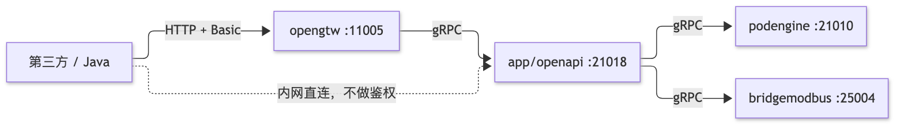

# 开放 API 网关

`opengtw` 面向第三方应用提供统一的 HTTP/JSON 入口，负责 Basic 鉴权、按应用验签、统一响应和请求日志。`app/openapi` 按 `method` 转发到 Podman、Modbus 或 GIS，并按下游契约转换 protojson。

专题参考见 [凭据与请求签名协议](./signature.md)、[Modbus 方法与示例](./modbus.md)、[GIS 方法与示例](./gis.md)和 [Nacos 注册与发现](./nacos.md)。

## 架构与端口

<div align="center">
  
</div>

上图以 Podman 和 Modbus 为例，GIS 走同一条转发链路。

| 服务 | 目录 | 端口 | 说明 |
| --- | --- | --- | --- |
| `opengtw` | `app/opengtw` | 11005 | HTTP 网关，`/v1/*` 与 `/open-admin/v1/*` |
| `openapi` | `app/openapi` | 21018 | gRPC 转发服务，`OpenApiRpc.Invoke` |
| `podengine` | `app/podengine` | 21010 | 下游容器管理服务 |
| `bridgemodbus` | `app/bridgemodbus` | 25004 | 下游 Modbus TCP 读写服务 |
| `gis` | `app/gis` | 25006 | 下游地理信息服务 |

## 测试控制台

`web/openapi` 是配套的浏览器调试台：

- 开发端口 `5181`，生产挂在 `/openapi/`。
- 接口测试目录收录 51 个方法（Podman 4、Modbus 23、GIS 24），支持跨服务搜索、JSON 编辑、写操作确认及响应详情。实际可调用的方法以转发服务注册结果为准。
- 应用管理：JWT 鉴权，创建、启停、重置密钥，secret 只展示一次。
- 请求历史：最近 50 条，支持过滤与回填；不保存 secret。
- 错误码速查：BC=30 与常用 extproto 错误码。

开发态 Vite 会把 `/v1` 和 `/open-admin` 代理到 `127.0.0.1:11005`；生产态由 nginx 反代 `/v1/`，默认不转发 `/open-admin/`。详见 [`web/openapi/README.md`](../../web/openapi/README.md)。

## 鉴权

```http
Authorization: Basic base64(appId:secret)
```

- `appId` 为 `app_` 加 32 个十六进制字符。创建或重置凭据时返回 `secret`，开启签名的应用同时返回 `signKey`。`secret` 丢失后需重置，当前生效的 `signKey` 可在管理面按配置查看。
- 服务端只保存 `sha256(secret)` 的十六进制摘要，并使用常数时间比较。
- 应用不存在或已停用返回 `130001`；密钥缺失或不匹配返回 `130002`。HTTP 状态统一为 200，业务结果以响应体 `code` 为准。
- 凭据缓存在内存中，每 60s 从凭据库刷新；管理面变更后立即刷新。本地默认使用金仓 `zero` 库，生产建议独立 `resource` 库。
- 每个应用每分钟最多更新一次 `last_used_at`，不会逐请求查库。

## 统一转发

```http
POST /v1/gateway
Content-Type: application/json
Authorization: Basic ...
```

请求：

```json
{
  "method": "pod.list",
  "data": {"node": "local", "limit": 100, "offset": 0},
  "tid": "req-20261022-0001"
}
```

应用的 `signRequired` 为 `true` 时，请求必须携带 `X-Sign: v1:<hex>`，并把 `timestamp`、`nonce` 放进 body：

```http
POST /v1/gateway
Authorization: Basic ...
X-Sign: v1:a21688f6f7bd082ead7fa5b1a34eb48899210c7702d808d6413e3197cbea13ba
Content-Type: application/json

{"method":"pod.list","data":{"limit":100,"offset":0},"tid":"req-001","timestamp":1761120000000,"nonce":"nonce-001"}
```

签名 canonical string 固定为 4 行（换行分隔）：

```text
v1
{appId}
{path}
{bodyHash}
```

签名使用 `HMAC-SHA256`，`bodyHash` 是整个原始请求体的 SHA-256 小写十六进制摘要。`data` 以 JSON 对象传入，缺省时按 `{}` 处理。`timestamp` 允许与服务端相差 5 分钟，`nonce` 由 Redis 占用 10 分钟。未开启签名的应用只需 Basic 鉴权。

密钥格式、`secret`/`signKey` 的密码学处理、canonical string 详解和完整示例见 [`signature.md`](./signature.md)。

响应：

```json
{"code": 0, "msg": "ok", "data": {}, "timestamp": 1761120000000}
```

- 网关业务响应使用 HTTP 200，以 `code=0` 判断成功。响应含 `code`、`msg` 和网关生成的 Unix 毫秒时间戳 `timestamp`。成功时 `data` 为下游 protojson 对象，失败时省略 `data`。代理或基础设施错误可能使用其他 HTTP 状态。
- HTTP 中间件优先复用合法的请求头 `X-Request-Id`，缺失或无效时生成。当前 `/v1/gateway` 在通过鉴权并解析请求体后，会用非空 `tid` 覆盖响应头 `X-Request-Id`，并将 `tid` 转发给 `Invoke`。省略 `tid` 时沿用中间件的请求 ID。鉴权或解析失败发生在覆盖之前。
- 链路追踪 ID 由追踪系统维护。当前开放 API 没有定义 `X-Trace-Id` 响应头。
- HTTP 网关保留 `data` 的 JSON 内容，转发服务按对应 RPC 的请求和响应消息进行 protojson 编解码。

### 可用 method

#### Podman

| method | 下游 RPC | `data` 请求字段 |
| --- | --- | --- |
| `pod.list` | `podengine.PodEngine/ListPods` | `node`、`limit`、`offset`、`names`、`ids`、`labels` |
| `pod.get` | `podengine.PodEngine/GetPod` | `node`、`id`（必填） |
| `pod.stats` | `podengine.PodEngine/GetPodStats` | `node`、`id`（必填） |
| `image.list` | `podengine.PodEngine/ListImages` | `node`、`limit`、`offset`、`references`、`includeDigests` |

`node` 默认 `local`。请求和响应字段以 [podengine.proto](../../app/podengine/podengine.proto) 为准。

#### Modbus

共 23 个方法，包括 15 个 I/O、3 个寄存器换算和 5 个链路配置管理方法。完整清单和示例见 [Modbus 开放接口](./modbus.md)。

#### GIS

共 24 个方法，覆盖 GeoHash、H3、围栏计算与管理、距离、坐标转换和路径优化。完整清单和示例见 [GIS 开放接口](./gis.md)。

未注册的 `method` 返回 `130004`。

### 请求示例

```bash
curl -sS -X POST http://127.0.0.1:11005/v1/gateway \
  -H 'Content-Type: application/json' \
  -u 'app_0123456789ab:sec_0123456789abcdef0123456789abcdef' \
  -d '{
    "method": "pod.list",
    "data": {"node": "local", "limit": 20, "offset": 0},
    "tid": "demo-1"
  }'
```

### 存活探针

```http
GET /v1/health
```

无需鉴权。成功时 `code=0`、`data.status="ok"`，并带响应时间戳。该端点用于检查网关存活。

## protojson 注意事项

- 字段以各下游 proto 的 JSON 名称为准，例如 `includeDigests`、`modbusCode`、`h3Index`。
- `int64` / `uint64` 在输出中固定为字符串；输入时也接受数字。
- 枚举使用名称，例如 `POD_PHASE_RUNNING`。
- `bytes` 字段输出为 base64 字符串，例如 Modbus 的 `results`。
- 未知字段会被拒绝，返回 `100020`（HTTP 200 + 业务码）。
- 32 位整型也接受数字字符串，例如 `{"limit":"100"}`。响应可能省略默认值字段和空数组，客户端应按 proto 字段的默认值处理。

## 错误码

| code | 语义 HTTP | 含义 |
| --- | --- | --- |
| `0` | 200 | 成功 |
| `100001` | 500 | 系统内部错误 |
| `100002` | 500 | 系统繁忙（网关 `Error.Fold` 命中后的对外码） |
| `100003` | 504 | 系统超时 |
| `100004` | 408 | 请求已取消 |
| `100020` | 400 | 参数错误 / data 不是合法 protojson |
| `100021` | 400 | 缺少必要参数 |
| `100052` | 404 | 记录不存在 |
| `100110` | 401 | 未认证 |
| `100113` | 403 | 无权限访问 |
| `100141` | 409 | 业务状态不允许 |
| `100184` | 502 | 第三方接口错误（`msg` 固定模板，强制透传） |
| `100220` | 429 | 请求过于频繁 |
| `130001` | 403 | 应用不存在（不存在与已停用统一返回） |
| `130002` | 401 | 应用密钥无效 |
| `130004` | 404 | 方法未开放 |
| `130005` | 429 | 请求超过限制（本期占位） |
| `130006` | 401 | 签名无效 |

下游错误优先读取 `google.rpc.ErrorInfo.reason`，取不到时按 gRPC Code 映射。已登记码默认透传。仅当 `Error.Fold.Enabled: true` 且错误码命中 `Codes` 时，才折叠到 `Target`（未设或无效时用 `100002`）。`KeepMsg` 控制是否保留原文。`100184` 始终透传厂商码与原文。

## 管理接口

与开放面同端口 `11005`，前缀 `/open-admin/v1`，使用 JWT 鉴权（`JwtAuth.AccessSecret`），并复用 `authctx` 中间件。

```http
POST /open-admin/v1/app/create        创建应用，secret 仅返回一次
GET  /open-admin/v1/app/list          列表（keyword/status/pageNum/pageSize）
POST /open-admin/v1/app/disable       启用或停用（status=1/2）
POST /open-admin/v1/app/secret/reset  重置密钥，旧密钥保留 24h
POST /open-admin/v1/app/sign-key/reveal  查看当前 signKey（受 SignKeyRevealEnabled 控制）
```

- 创建：`{"name":"示例应用","remark":"开放平台接入","signRequired":false}`，返回 `appId`、`secret`；`signRequired=true` 时还返回一次 `signKey`。
- 列表：`GET /open-admin/v1/app/list?keyword=&status=&pageNum=1&pageSize=20`。
- 停用：`{"appId":"app_xxx","status":2}`；可选 `signRequired` 同时切换是否要求签名。
- 重置：`{"appId":"app_xxx"}`；旧密钥 `status=2` 且 `expire_at=now+24h`，新密钥立即生效；应用开启签名时同时返回新的 `signKey`。
- 查看签名密钥：`{"appId":"app_xxx"}`，返回当前 `status=1` 记录的明文 `signKey`；只对 `signRequired=true` 的应用生效，需要配置 `SignKeyEncryptionKey` 且 `SignKeyRevealEnabled=true`，成功时记录 `app_id` 与操作人审计日志。
- `secret` 仍然只存 sha256 摘要，服务端无法找回，丢失只能重置；`signKey` 可通过上述管理接口查看（受开关控制），也可以通过本地 `cmd/keytool` 解密。
- 管理面同样使用 `HTTP 200 + {code,msg,data,timestamp}`：JWT 缺失/过期/签名错误返回 `200 {"code":100110,"msg":"未认证","timestamp":1761120000000}`，不再使用 HTTP 401。
- 管理面响应带 `Cache-Control: no-store`，避免凭据被浏览器或代理缓存。
- nginx 不对外转发 `/open-admin/`，该前缀应只在内网访问。

## gRPC 内网直连

Java 等内网调用方可跳过 HTTP 网关，直接调用 `app/openapi`：

- 契约：`app/openapi/openapi.proto`
- 服务：`openapi.OpenApiRpc/Invoke`
- `InvokeReq`：`app_id`、`method`、`data`（protojson string）、`tid`。HTTP 签名字段留在网关层。
- `InvokeRes`：`data`（成功时的 JSON string）；失败通过 gRPC status 返回，六位码位于 `ErrorInfo.reason`
- 直连路径不做鉴权，依赖网络隔离；`app_id` 由调用方填写，仅用于日志与后续限流扩展。
- 新增 method 不需要修改 proto，Java stub 只需生成一次。

## 启动与配置

```bash
# 转发服务（请先启动待调试接口的下游服务）
cd app/openapi && go run . -f etc/openapi.yaml

# HTTP 网关
cd app/opengtw && go run . -f etc/opengtw.yaml
```

`app/openapi/etc/openapi.yaml`：

- `PodEngineConf`：podengine 地址与超时（默认 120s）。
- `BridgeModbusConf`：bridgemodbus 地址与超时（默认 120s）。
- `GisConf`：GIS gRPC 地址，仓库配置默认使用 `127.0.0.1:25006`。省略该配置时不注册 GIS 方法。

`app/opengtw/etc/opengtw.yaml`：

- `DB.DataSource`：默认指向本地金仓 `zero` 库；生产建议独立 `resource` 库。仅在 dev/test 自动创建 `open_app`、`open_app_secret`。
- `OpenApiConf`：`app/openapi` 地址，超时 120s。
- `SignKeyEncryptionKey`：签名应用的签名 key 加密主密钥；仅存在 `signRequired=true` 应用时必填，使用配置文件直接配置，不提交真实密钥。
- `Redis`：签名 nonce 防重放存储；仅存在 `signRequired=true` 应用时必填。
- `JwtAuth.AccessSecret`：管理面 JWT 密钥，默认与 `gtw`/`livegtw` 一致，本地签发的 token 可直接复用。
- `MaxBytes: 1048576`：单请求体上限 1 MiB。

## 数据模型

| 表 | 说明 |
| --- | --- |
| `open_app` | 应用主表：`app_id`（varchar(40)）、`name`、`remark`、`status`、`sign_required`、`last_used_at` |
| `open_app_secret` | 密钥表：`app_id`（varchar(40)）、`secret_hash`（sha256 hex）、`sign_key_cipher`（加密后的签名密钥）、`status`、`expire_at` |

`status`：应用 `1-启用 2-停用`；密钥 `1-生效 2-待失效 3-已失效`。没有 SQL 迁移文件，表结构由 GORM 模型提供，开发/测试环境启动时自动迁移。

生产环境不会自动迁移，升级到本版本前需要手工执行（金仓 / PostgreSQL）：

```sql
ALTER TABLE open_app ALTER COLUMN app_id TYPE varchar(40);
ALTER TABLE open_app ADD COLUMN sign_required boolean NOT NULL DEFAULT false;
ALTER TABLE open_app_secret ALTER COLUMN app_id TYPE varchar(40);
ALTER TABLE open_app_secret ADD COLUMN sign_key_cipher text;
```

## 风险与边界

- Podman、Modbus 和 GIS 的 proto 字段及枚举都是开放契约的一部分，变更前需检查调用方兼容性。
- 管理面与开放面同端口，部署时必须确认 nginx 没有转发 `/open-admin/`。
- 仓库配置中的网关与 RPC 超时为 120 秒。部署时应协调客户端、网关与反向代理的超时设置。
- Modbus 写入和链路配置变更，以及 GIS 围栏新增、修改、删除，都会改变下游状态。开放面当前按应用验凭据，部署时应按调用方信任范围控制入口访问。
